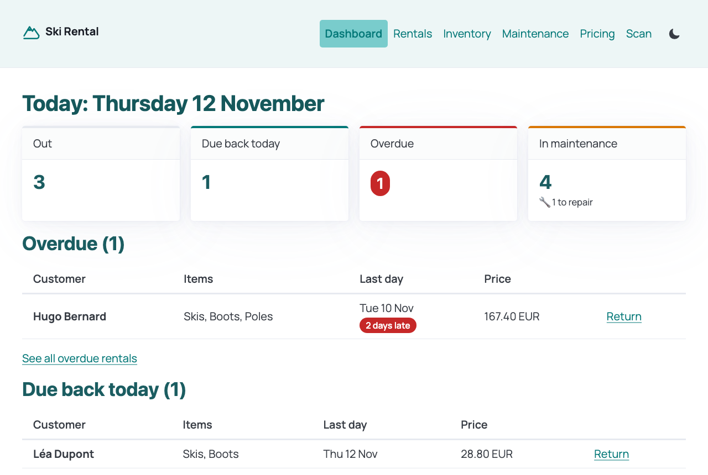
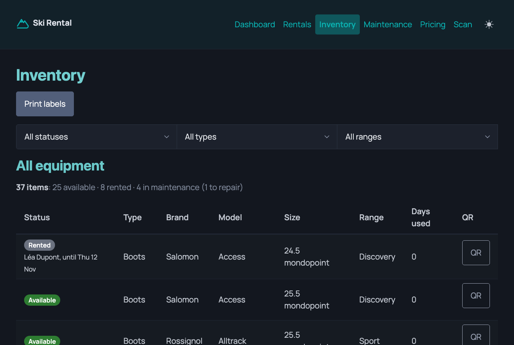
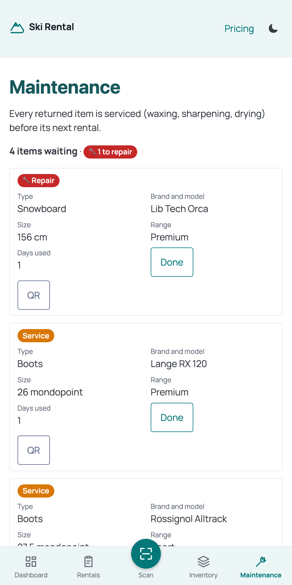
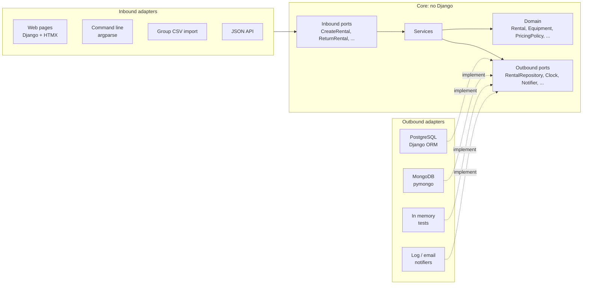

# hexagonal-ski-rental

A ski and snowboard rental app for a winter-season shop, built with Django to demonstrate
**hexagonal architecture (ports and adapters)**.

**Live demo: https://hexagonal-ski-rental.onrender.com**

> The demo has no login: anyone can try everything. Its data goes back to the demo set every
> night. It sleeps after 15 minutes without visitors, so the first page can take about a
> minute to load.



## Why this project

A rental shop has real business rules: which items are available, which size and range suit
a customer, prices by range and period, a week that runs Sunday to Friday, damage and
maintenance after every return.

The goal is to keep those rules in a **core that knows nothing about Django, the database or
the screens**, and to show that the technology around it can be swapped or added without
touching the core. Over the project, the same core gained:

- 4 ways in: web pages, a command line, a group CSV import and a JSON API
- 2 databases: PostgreSQL (Django ORM) and MongoDB
- 2 notification channels: a log and an email to the shop
- an editable price list, stored in either database

## What the shop can do

Staff at the counter use it. Rentals are made in person and start the same day.

- **Inventory**: register skis, snowboards, boots, helmets and poles; see every item with its
  status (available, rented by whom and until when, in maintenance); print QR stickers.
- **Rent**: register the customer; the app recommends a range and a size (from height, boot
  size and skill level) and lists the items that fit; staff choose the items and the last day;
  the price is computed.
- **Return**: every returned item goes to maintenance (waxing, sharpening, drying); a damaged
  one is also flagged for repair.
- **Maintenance**: mark an item as done, and it is available again.
- **Dashboard**: what is out, due back today, overdue, in maintenance.
- **Pricing**: edit the day and week rates per type and range. A rental keeps the price it
  was made with.
- **Scan**: scan an item's QR sticker with a barcode scanner or a phone camera to open its
  page: rent it, return its rental, or finish its maintenance.
- **Group import**: a ski school's CSV file of children, each fitted and rented in one go.

| Inventory, dark mode | On a phone |
|---|---|
|  |  |

### Business rules

- A ski week runs **Sunday to Friday: 6 days**. Days are counted with the first and the last
  included.
- Per item: each block of 6 days costs the week rate; the remaining days cost the day rate,
  capped at one week rate. The week rate must be lower than 6 day rates.
- Skis or a snowboard **with boots** get **10% off** the whole rental.
- Range suggestion: beginner → discovery, intermediate → sport, advanced and expert → premium.
  Only a suggestion: staff can rent any range.
- Size suggestion: skis are the customer's height minus 15 to 0 cm, a snowboard minus 25 to
  15 cm, depending on the level; boots are the customer's boot size. An item fits within
  ± 5 cm, or ± 0.5 mondopoint for boots.
- A rental is **overdue** when it is still out after its last day. This is computed from
  today's date, never stored.
- Equipment goes `AVAILABLE → RENTED → MAINTENANCE → AVAILABLE`, and can be retired at any
  time. Only a customer who never rented can be removed: rentals are the shop's history.

## Architecture



- **Domain** (`rental/domain/`): entities, value objects (`RentalPeriod`, `Money`, `Size`,
  `SkillLevel`, `Range`) and business rules, in plain Python.
- **Inbound ports** (`application/ports/inbound/`): the use cases the app offers, such as
  `RegisterEquipment`, `RecommendEquipment`, `CreateRental`, `ReturnRental`,
  `CompleteMaintenance`, `GetDashboard`, `UpdatePriceList`. Each takes a command dataclass and
  returns a result dataclass: no HTTP request or ORM model ever crosses.
- **Services** (`application/services/`): implement the use cases with the domain and the
  outbound ports.
- **Outbound ports** (`application/ports/outbound/`): what the core needs: the repositories
  (one per aggregate), `PriceListRepository`, `UnitOfWork`, `Clock`, `Notifier`. All are
  `typing.Protocol` classes.
- **Adapters** (`rental/adapters/`): the technology plugged into the ports.
- **Composition root** (`rental/bootstrap.py`): the only place that chooses the adapters and
  builds the services. The web views receive their use cases by injection in
  `config/urls.py`; they never build an adapter.

### Swapping an adapter

Two settings choose adapters. They are read only in `bootstrap.py`, and the core never
changes:

```bash
REPOSITORY_BACKEND=mongo     # orm (PostgreSQL, the default) or mongo
NOTIFIERS=logging,email      # logging, email, or both
```

### Boundaries checked in CI

[import-linter](https://github.com/seddonym/import-linter) fails the build when:

- the core (`domain`, `application`) imports Django
- a dependency points outward (the order is `adapters → application → domain`)
- an inbound adapter imports an outbound one, or the reverse

### Tests

- **Domain and use cases**, the majority: plain pytest with in-memory adapters, a fixed clock
  and a recording notifier. No database.
- **Repository contracts** (`tests/contract/`): one set of tests runs against all three
  adapters (in memory, PostgreSQL, MongoDB), so they behave the same.
- **Web adapters**: views tested with fake use cases injected, so no database is needed.
- **A few integration tests** go through the real stack.

## Entry points

The same use cases, with the same injection, behind four adapters:

| Adapter | How to use it |
|---|---|
| Web | http://localhost:8000: Django templates and HTMX, server-rendered, works without JavaScript |
| Command line | `docker compose run --rm web python manage.py ski_rental --help` (`available`, `customer`, `rent`, `return`) |
| Group CSV import | Rentals → *Import a group*, with a file like [examples/ski_school_group.csv](examples/ski_school_group.csv) |
| JSON API | `/api/equipment/` (GET), `/api/customers/` (POST), `/api/customers/<id>/recommendation/` (GET), `/api/rentals/` (POST), `/api/rentals/<id>/return/` (POST); needs `Authorization: Bearer <device key>` (`API_KEYS`) |

## Run it locally

Requires Docker.

```bash
cp .env.example .env
```

```bash
docker compose up --build
```

The app runs on http://localhost:8000 (PostgreSQL, MongoDB and Mailpit start with it).
To fill it with demo data:

```bash
docker compose run --rm web python manage.py seed_demo
```

The checks CI runs:

```bash
docker compose run --rm web pytest
```

```bash
docker compose run --rm web lint-imports
```

```bash
docker compose run --rm web ruff check .
```

```bash
docker compose run --rm web ruff format --check .
```

Emails sent in development are caught by Mailpit: http://localhost:8025.

## Deployment

Every merge into `main` is deployed once CI is green, on free plans only:

- **[Render](https://render.com)** runs the `Dockerfile` (gunicorn, WhiteNoise for static
  files). Its settings are in `render.yaml`.
- **[Neon](https://neon.com)** holds the PostgreSQL database.
- **GitHub Actions** runs CI on every pull request, and resets the demo data every night
  (`.github/workflows/reset-demo.yml`).

The setup steps are in [ROADMAP.md](ROADMAP.md), step 20.

## Stack

Python 3.12, Django 5.2, HTMX, Pico.css, PostgreSQL 16, MongoDB 7, segno (QR codes), pytest,
import-linter, ruff, Docker, GitHub Actions, Render, Neon.

## How it was built

Step by step, one branch and one pull request per step, from the core outward: domain, use
cases, the first adapters, then new adapters next to the existing ones, then the design and
the deployment. See [ROADMAP.md](ROADMAP.md).
